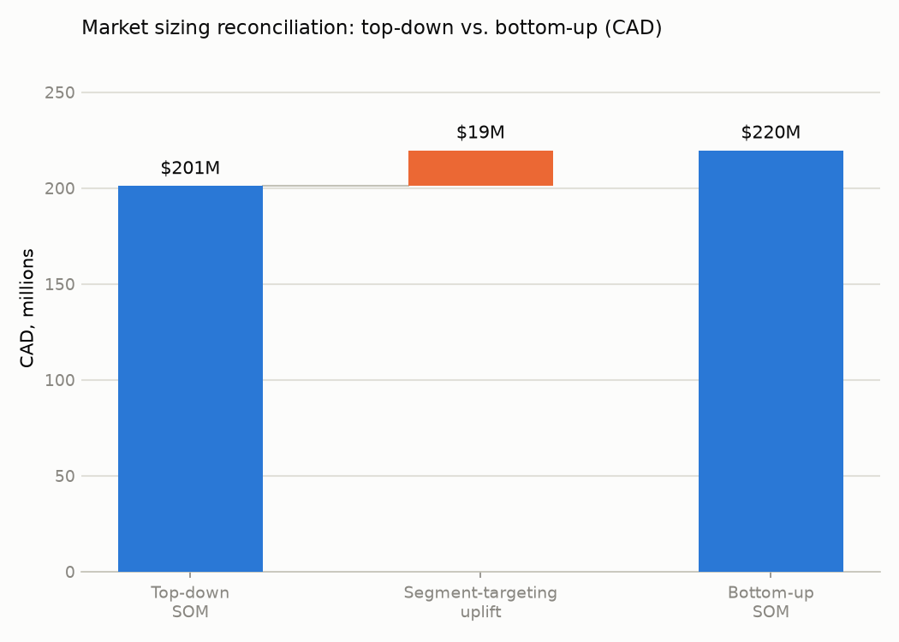
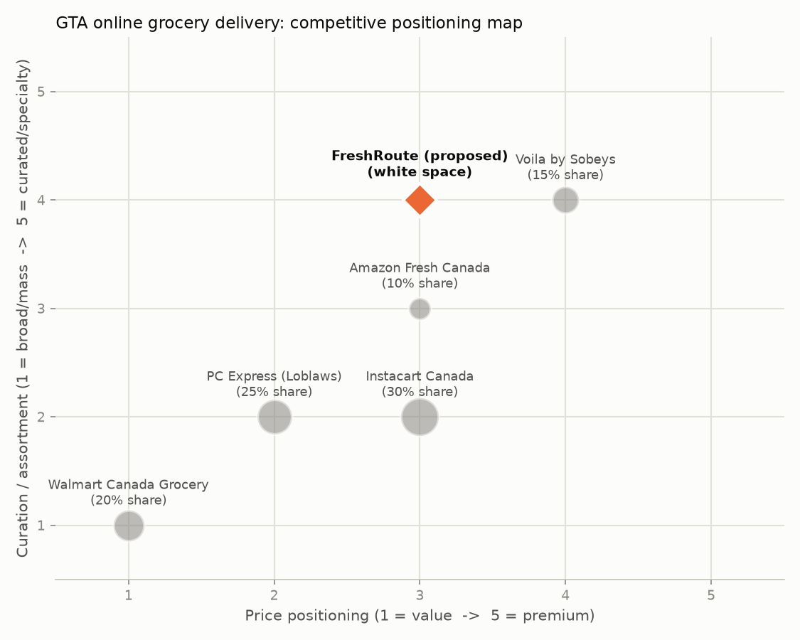
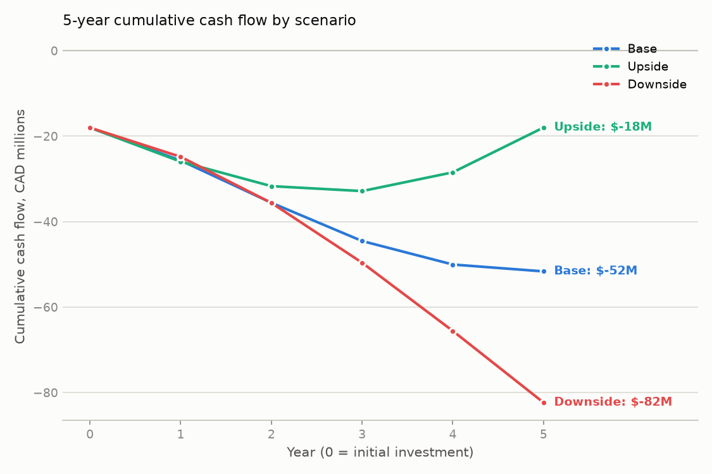

# Recommendation Memo: FreshRoute

**Question:** Should FreshRoute enter the Greater Toronto Area (GTA) online grocery delivery market?

## Situation

FreshRoute asked us to determine whether entering the Greater Toronto Area online grocery delivery market is a good use of capital, and if so, how. We structured the question into four testable hypotheses -- market attractiveness, competitive intensity, capability fit, and financial viability -- and ran a dedicated analysis against each.

## Complication

**Market sizing.** Top-down: CA online grocery market ≈ $12.75B CAD → GTA online grocery ≈ $2.63B CAD → GTA online *delivery* ≈ $1183M CAD → realistic new-entrant SOM ≈ $201M CAD ($147M USD). Bottom-up: 805,000 serviceable GTA households → 40,250 active customers at maturity (each ordering 52x/yr, $5,460 CAD/yr) → SOM ≈ $220M CAD ($160M USD). The bottom-up estimate comes in 9% higher than top-down ($220M vs. $201M CAD). This is expected and explainable, not a red flag: top-down applies an average obtainable share across the *entire* GTA online-delivery market, including households FreshRoute would never target (outside delivery zones, price-insensitive club-store shoppers, etc.). Bottom-up instead targets FreshRoute's actual go-to-market segment -- digitally engaged, dual-income households inside serviceable postal codes -- which converts at a higher rate than the market-wide average baked into the top-down share assumption. In a client meeting we would present the bottom-up number as the operating plan target and the top-down number as the sanity-check ceiling, and flag that the 9% gap is within the +/-20% range we'd expect from two independently-built estimates at this stage of diligence.

**Competitive benchmarking.** HHI = 2,250 (moderately concentrated); largest incumbent holds 30% share. No competitor exceeds ~30% -- the market is fragmented enough that a well-differentiated new entrant can realistically take share without displacing a single dominant player. On a price (1=value, 5=premium) x curation (1=broad/mass, 5=curated/specialty) grid, the proposed FreshRoute position (price=3, curation=4) sits in open space between the two nearest incumbents, Voila by Sobeys and Amazon Fresh Canada. Walmart Canada wins on price but offers minimal curation; Voila by Sobeys offers strong curation but at a premium price and with limited coverage. FreshRoute's mid-price, high-curation position -- reliability plus fresh/local sourcing without Voila's premium markup -- is not directly contested by any incumbent at scale, and matches FreshRoute's existing brand positioning in its US markets.

**Financial feasibility.** Base: Y5 revenue $220M, Y5 EBITDA $-1.6M, payback no payback within 5yr, NPV $-44.6M, IRR n/m. Upside: Y5 revenue $275M, Y5 EBITDA $10.5M, payback no payback within 5yr, NPV $-21.3M, IRR -18.2%. Downside: Y5 revenue $154M, Y5 EBITDA $-16.8M, payback no payback within 5yr, NPV $-64.9M, IRR n/m. None of the three scenarios achieve payback within the modeled 5-year horizon under the full $18M CAD launch investment; NPV is negative in all three at a 10% discount rate over this horizon, though the model excludes terminal value beyond year 5, when base/upside cash flow is solidly positive.

Taken together, the hypothesis tree rolls up to **not supported for a full-scale launch as originally framed -- three of four branches are strongly supportive, and the fourth (financial viability) fails specifically because of the capital intensity of a full-scale build, not because the underlying opportunity is bad. That reframes the ask rather than closing it -- see the recommendation below.**

## Resolution

**Recommendation:** Conditional go: the market opportunity, competitive white space, and operating-model fit all clear the bar. The standalone financial case for a full ~$18M CAD upfront launch does not clear payback within a 5-year horizon under any modeled scenario. Recommend proceeding, but restructured as a milestone-gated phased investment — a smaller, partnership-based pilot in a subset of the GTA to prove out retention, delivery cost, and CAC assumptions — with a formal reassessment of full-scale build-out economics at the 18–24 month mark.

## Supporting evidence

- ✅ **The Canadian (GTA) online grocery market is large enough and growing fast enough to be worth entering** (supported)
- ✅ **Competitive intensity is manageable -- there is a defensible white-space position for a new entrant** (supported)
- ⚠️ **FreshRoute's operating model transfers to Canada without a fundamentally new capability build** (partially supported)
- ❌ **The entry is financially worth it on a risk-adjusted basis** (not supported)

## Exhibits

### Exhibit 1 — Market sizing reconciliation

### Exhibit 2 — Competitive positioning map

### Exhibit 3 — 5-year cumulative cash flow by scenario

---
*This memo was AI-drafted (template mode — see `memo_synthesis.py`) from the quantitative outputs of `market_sizing.py`, `competitive_benchmarking.py`, and `financial_feasibility.py`, and reviewed against the human-in-the-loop checklist above before being finalized. All data is illustrative/public-proxy data — see the README for the full disclaimer. This is a case-study exercise, not investment advice.*
